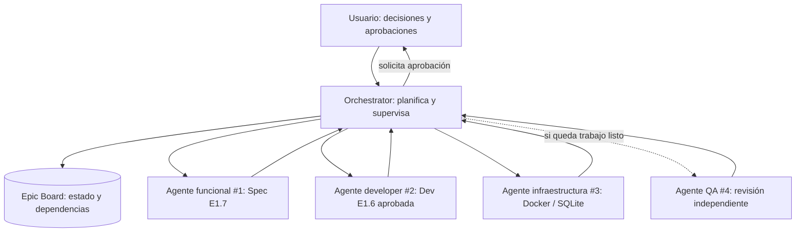
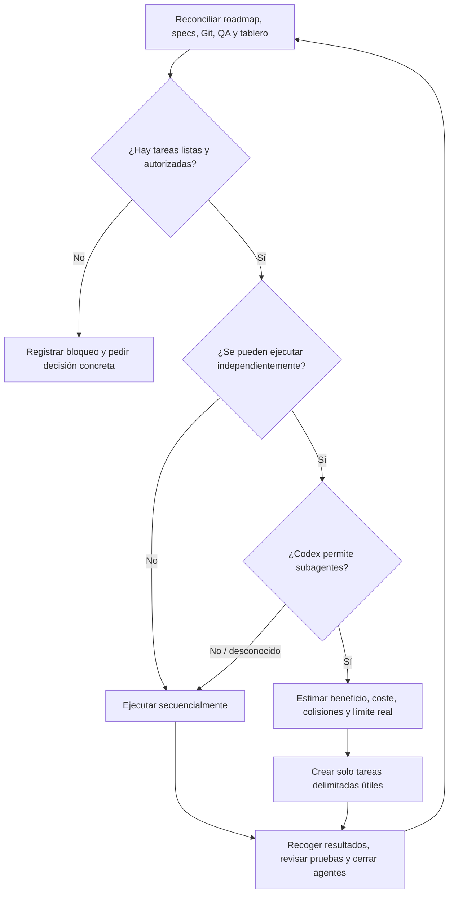
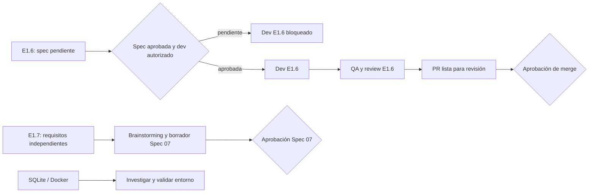
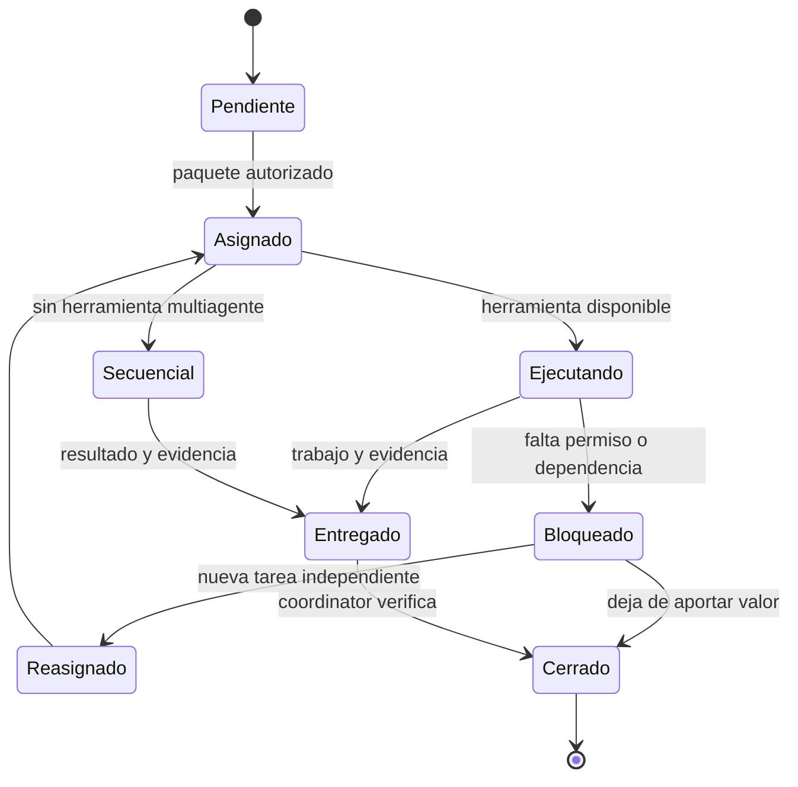
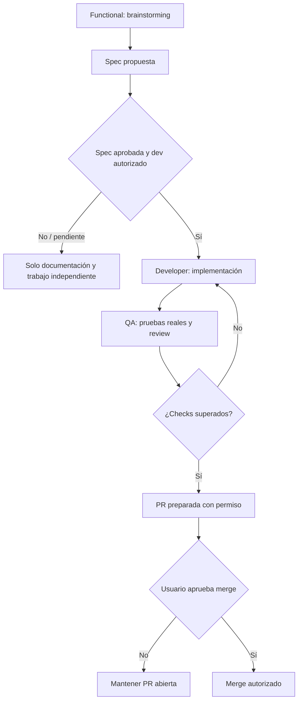
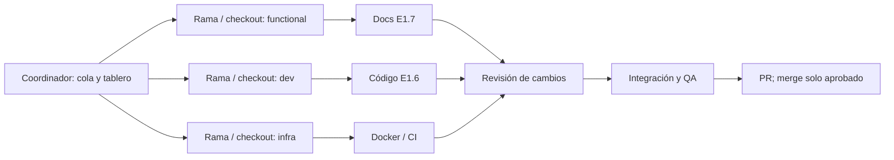
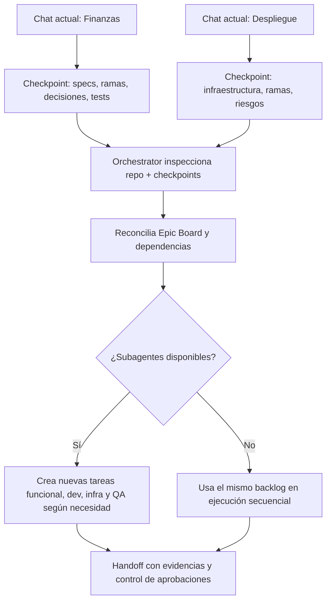
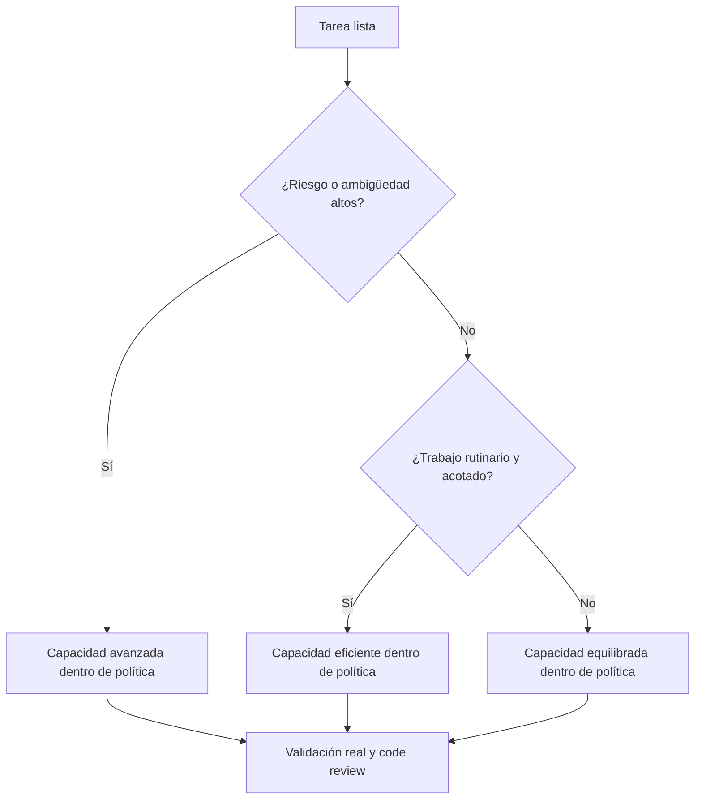

# Guía visual: Orchestrator y agentes dinámicos — v2.3.1

> **Objetivo:** trabajar con un único coordinador de desarrollo, que distribuye tareas independientes según el estado real del proyecto. No significa que un Skill cree agentes automáticamente ni que los agentes sigan activos fuera de una ejecución de Codex.

**Adaptación MyFinanzas:** [reglas locales y autorizaciones](../specs/methodology/myfinanzas-coordination.md).
Los ejemplos de E1.7 del upstream son ilustrativos, no crean una entrega del roadmap
real. En MyFinanzas, aprobar una spec NO basta para iniciar dev: hace falta autorización
expresa de desarrollo. La adopción no inicia dev06 ni spec07. No copiar CI ni desplegar.

**Cómo empezar:** [README](../README.md) · [Política de agentes dinámicos](../specs/methodology/dynamic-agents.md) · [Coordinación de épicas](../specs/methodology/epic-orchestration.md) · [Modelos](../specs/methodology/model-selection.md) · [Tablero](../templates/epic-board.md).

## 1. La arquitectura: un coordinador, agentes bajo demanda

Los roles son **instrucciones reutilizables**. Cada instancia recibe una misión concreta, entrega un resultado y termina. No hay un agente permanente por cada rol. Un rol puede asignarse a varios agentes distintos si sus tareas no se pisan.

El gráfico muestra **cuatro ejemplos de tareas**, no cuatro agentes permanentemente ejecutándose. La recomendación inicial es uno a tres agentes activos y aumentar solo cuando compense y el entorno lo permita.

## 2. Cómo decide cuántos agentes crear

No se trata de tener tres agentes y buscarles trabajo, sino de encontrar trabajo **independiente y autorizado** y asignar los recursos justos.

**Reglas:** Quick suele usar uno; Standard puede usar varios; Full puede coordinar varias líneas. Empezar con **uno a tres**, si hay trabajo útil, es una heurística, **no** un máximo rígido ni un límite técnico universal. Más de tres solo si hay beneficio real, capacidad de ejecución y aislamiento seguro.

## 3. Varias épicas sin bloqueo en serie

Ejemplo **ilustrativo**, no el estado verificado del repositorio MyFinanzas. E1.6 está esperando una decisión financiera; E1.7 contiene aspectos que se pueden preparar independientemente; SQLite puede investigarse en una línea técnica separada.

La investigación técnica **solo bloquea** una épica si se ha documentado una dependencia real. Mientras una especificación espera tu decisión, preparar otra especificación o pruebas provisionales no necesita bloquearse también.

## 4. El ciclo de vida de cada subagente

Cada paquete debe indicar **qué quiere conseguir, qué archivos puede escribir, sus dependencias, las pruebas obligatorias y cómo devolverá resultados**. Usa [el contrato reutilizable](../templates/agent-work-packet.md).

## 5. Las aprobaciones siguen protegidas

Se requiere tu autorización para decisiones financieras y contables, contratos importantes, migraciones destructivas, producción y merges. La aprobación de una spec **no autoriza** por sí sola desarrollo, operaciones destructivas o despliegues en MyFinanzas.

## 6. Proteger ramas y archivos entre agentes

**No presupongas que cada agente recibe automáticamente una rama o worktree.** Los cambios paralelos necesitan ownership sin solapamiento e aislamiento explícitamente autorizado. Si dos tareas van a editar el mismo archivo, se serializan o se negocia una separación real. La investigación de solo lectura puede compartir repositorio.

## 7. Migrar dos chats existentes a un coordinador

No es posible convertir mágicamente dos chats ya abiertos en subagentes del nuevo coordinador. Hay que conservar primero lo que saben mediante checkpoints verificables.

**Secuencia práctica:**

1. Solicita a ambos chats un checkpoint; no los cierres hasta salvar cambios no confirmados en Git.
2. Actualiza la metodología del proyecto usando [$adopt-project](../.agents/skills/adopt-project/SKILL.md) y copia solo las partes necesarias, sin sobreescribir reglas existentes.
3. Abre un nuevo chat, escribe `$orchestrate` y solicita reconciliar ramas, roadmap, aprobaciones y checkpoints.
4. Valida la primera propuesta de Quick / Standard / Full. El coordinador administra el tablero y selecciona tareas ya autorizadas.
5. Cuando el traspaso esté verificado, deja los dos chats antiguos solo como histórico. **El coordinador no puede tomar control, cerrar o enviar mensajes a esos chats automáticamente.**

## 8. Asignación de modelo por dificultad, no por rol fijo

La selección respeta la [política canónica de modelos](../specs/methodology/model-selection.md) y las capacidades verificadas del cliente. Los subagentes Codex tienen un techo absoluto de GPT-6.1 Sol Light; el coordinador conserva su modelo. Si no puede garantizarse la selección permitida, no se crea el subagente. Nunca sustituir pruebas por capacidad o razonamiento.

## 9. ¿Qué instala realmente esta template?

| Pieza | Incluida | Límites |
| --- | --- | --- |
| Skill `$orchestrate` | Sí | Coordina por instrucciones; necesita herramientas reales para delegar |
| Roles Functional / Developer / QA / Infra | Sí | Son perfiles, no procesos residentes |
| Gestión dinámica / scheduler | Sí, como contrato | No es un servicio de ejecución en segundo plano |
| Epic Board | Plantilla opcional | Estado persistido por el coordinador, no autoridad de aprobación |
| Paquete de trabajo | Sí | Define ownership, verificaciones y handoff |
| Merge/Deploy automático | No | Requiere aprobación correspondiente |
| Sesiones Codex independientes antiguas | No gestionadas directamente | Se migran mediante checkpoint/Git |

La documentación de [OpenAI sobre multiagentes en Agents API](https://developers.openai.com/api/docs/guides/agents-api/multi-agent) describe una plataforma que se **configura por separado**. Que exista no prueba que tu Codex Desktop/Web tenga las mismas herramientas activadas.

## 10. Preguntas frecuentes

**¿Hay que activar `/plan`?** No. Puedes invocar `$orchestrate` directamente. Plan Mode es opcional.

**¿Tengo que llamar manualmente a `$spec` y `$dev`?** No necesariamente: dentro de una ejecución autorizada, el coordinador puede encadenar pasos aprobados. Jamás autoaprobará una especificación.

**¿Son obligatorios tres agentes?** No. Puede funcionar con uno, dos, tres o más tareas simultáneas si el entorno y el beneficio lo permiten.

**¿Funciona mientras no tengo abierto el chat?** La template no programa ejecuciones ni garantiza trabajo de fondo. Recupera estado y reanuda cuando vuelvas a iniciar una tarea.

**¿Cómo sé que ha funcionado?** Ejecuta los [escenarios de aceptación](../specs/methodology/acceptance-scenarios.md) y comprueba tareas delegadas realmente, commits, pruebas y decisiones.

---

**Validación:** sintaxis Mermaid y prueba negativa se ejecutan como tooling temporal
fuera del proyecto; se conserva intacta la CI existente. Ver evidencia de adopción.

**Mantenimiento:** cuando cambien las Skills o los contratos de agentes, actualizar los diagramas, las rutas y los escenarios de aceptación; evitar documentación que afirme capacidades no comprobadas.
