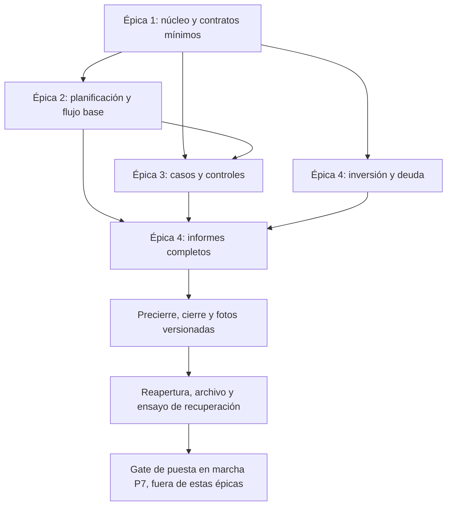

# MyFinanzas App · STEP 4 — Roadmap

Status: APPROVED — STEP 4 completado: cuatro épicas y sus 30 entregas aprobadas.
Approval source/date: autorización expresa del usuario el 2026-10-20 para aprobar e
integrar PR #5. Aprobación de agrupación y distribución detallada confirmadas.
Main user experience: registrar y consultar la realidad financiera, planificar por ciclos
y ejercicio, revisar casos y patrimonio, conciliar y preservar cierres sin duplicar hechos.
Scope: exactamente las cuatro épicas y 30 entregas aprobadas, como unidades funcionales
verificables. No equivalen necesariamente a 30 sprints ni a 30 PR. No son funcionalidades
implementadas ni especificaciones STEP 5. El orden se guía por dependencias, sin fechas fijadas.

## Base y límites del roadmap aprobado
Base estable: MyFinanzas2026_v5.11(5).xlsx. Fuente leída: especificación funcional v5.11
adjunta; extracto sanitizado, procedencia, reglas R1–R6 y P1–P7 en
[referencia funcional](functional-reference-v5.11.md). La aprobación actual de la agrupación
prevalece sobre §14 del adjunto, redactado antes. El Excel físico y sus documentos originales
siguen fuera del repositorio y no han sido inspeccionados por Codex.

Aquí solo se planifica. No se aprueba SQL definitivo, ni se crean tablas, migraciones,
código, despliegues o datos reales. Los nombres de tablas del Excel indican responsabilidad
funcional, no estructura de persistencia. El stack confirmado se mantiene sin dependencias nuevas.
Las pruebas y resultados económicos descritos abajo son criterios FUTUROS, no tests ejecutados.
Antes de implementar cada entrega: especificación/UX/contratos y decisiones abiertas aplicables
aprobadas, aceptación trazada a pruebas y autorización de desarrollo en los STEPS correspondientes.

## Las cuatro épicas aprobadas

| Épica | Capacidad del usuario al completarla | Resultado observable | Exclusiones principales | Dependencias |
| --- | --- | --- | --- | --- |
| 1 — Núcleo financiero | Mantener Saldos/clasificación y registrar los cuatro tipos de Movimientos válidos | Registro consultable, saldos generales conciliables y errores estructurales bloqueados | Planificación completa, casos especializados, inversión y cierre financiero | Bootstrap y controles existentes; contratos mínimos de Ciclos, Referencias y Deudas dentro de E1 |
| 2 — Planificación | Gestionar Presupuestos, planes mensual/anual, Ciclos y Nómina, consultando flujo base | Plan y ejecutado distinguidos por periodo, sin ciclos nacidos de Nómina | Neto de casos aún no entregados, cierre/foto final y fotografía anual completa | E1; integraciones de casos en E3 y flujo completo en E4 |
| 3 — Gestión y controles | Seguir Referencias, Anticipos, Compartidos, Vehículos y Revisión Comida | Pendientes y conciliaciones verificables, sin gasto ni devoluciones duplicadas | Navidad, fiscalidad no especificada, inversión y cierre financiero | Maestros/Movimientos de E1 y Ciclos/Presupuestos de E2 |
| 4 — Patrimonio y cierre | Revisar inversión/deuda, Resumen e Histórico y cerrar/reabrir con evidencia versionada | Patrimonio y cierres coherentes, fotos inmutables y recuperación ensayada | Simulación avanzada, rectificación excepcional sin aprobar, migración real y cambio de maestro | Núcleo de E1; cálculo completo y cierre requieren E2/E3; doce incrementos abajo |

Cada épica aporta una capacidad financiera usable con fixtures, no una capa técnica aislada.
Ninguna equivale por sí sola a autorización de uso real: hasta P7 el Excel sigue siendo maestro.
En una entrega parcial, los tipos/motores todavía no soportados se indican como no disponibles;
no se inventan ceros, resultados o registros para simular cobertura completa. Solo puede
marcarse completa una entrega si pasan todos sus criterios dentro del alcance declarado.
Las integraciones aplazadas están asignadas a entregas concretas, no se dan por aprobadas antes.

## Dependencias funcionales y secuencia aprobada

- E1.3 establece el único maestro de Ciclos y el contrato de fecha de referencia; E2.1
  amplía su operación. Los lectores posteriores lo consumen, nunca crean otro maestro.
- E1.5 establece Referencias estables mínimas (Viaje/Evento); E3 habilita tipos con ficha
  únicamente al implementar su detalle coherente. No crear Anticipos/Compartidos/Vehículos huérfanos.
- E1.6 aporta Deuda mínima y reglas de cuota/amortización antes de declarar completos
  los cuatro tipos. E4.4 amplía esa misma deuda, sin remodelar Saldos ni Movimientos.
- E2.6 es flujo base. La atribución por Neto de Compartidos y Comida se completa en E3.6;
  fuentes de inversión y resumen anual con archivo se completan en E4.6/E4.7.
- E4.1–E4.4 pueden prepararse después del núcleo mientras avanzan E2/E3, si sus decisiones
  técnicas están aprobadas. Esa posibilidad no obliga a paralelizar personas ni entregas.
- E4.8–E4.11 quedan detrás de TODAS las fuentes con impacto financiero. Un formulario
  bloqueado de Movimientos no constituye protección de cierre transversal.
- No hay dependencia circular: los contratos mínimos y las vistas parciales se entregan
  primero; después se amplían fuentes y se verifica explícitamente la integración final.

## Condiciones transversales de todas las entregas

**T-SEG — Acceso e integridad.** Diseñar autenticación/sesiones/recuperación desde la primera
entrega; concretar DT1 antes de especificar sus rutas protegidas. Autorización del único
usuario en API, no solo en UI; pruebas de acceso denegado y escritura atómica. Seguridad de
sesión, validación, errores sin información sensible y protección de endpoints según el
mecanismo aprobado. MFA y HTTPS obligatorios antes de datos reales online; ningún registro
público. Desarrollo exclusivamente con fixtures y servicios locales hasta autorización expresa.

**T-UX — Responsive y accesibilidad.** Cada flujo se prueba con Playwright a 390 y 1440 px,
con capturas inspeccionadas, teclado/foco, mensajes y estados carga/vacío/error/éxito.
La identidad visual aportada en R6 guía la futura especificación UX; adaptar contraste
antes de aplicarla, sin calcar hojas de cálculo ni modificar el CSS en este STEP.

**T-DAT — Una fuente y trazabilidad.** IDs inmutables, invariantes en backend, cálculo
centralizado, ninguna clasificación por texto. Datos ficticios deterministas sin registros
personales en código, PR, logs o artefactos. Correcciones históricas explícitas con impacto;
prever el contrato de protección por cierre desde E1 y concretarlo antes de E4.8.

**T-BKP — Recuperación desde el inicio.** DT6 debe resolverse al especificar las primeras
escrituras útiles de E1. Ensayar copia coherente y restauración de fixtures desde E1,
y repetir al ampliar datos/contratos; considerar SQLite y su estado WAL, no copiar un
archivo abierto a ciegas. Copias y claves fuera de Git, cifrado/acceso/retención acordados,
restauración a entorno aislado y comprobación por UI/API. E4.12 es ensayo integral final,
no inicio de la estrategia. Una fotografía financiera no sustituye la copia restaurable.

**T-QA — Evidencia por incremento.** Cada entrega enlaza sus criterios AC a pruebas unitarias
de motor, integración API+SQLite y flujo UI cuando aplica. Incluir positivos, negativos,
límites de periodo y fallos con rollback. Expected failures de fixtures no son fallos de
suite; no pasar un caso omitido como correcto. Checks locales/CI y revisión del historial
antes de push; revisión y autorización de merge según [AGENTS](../AGENTS.md).
Los escenarios de abajo usan fixtures nuevos; no ejecutan importación ni equivalencia real.

## Épica 1 — Núcleo financiero (6 entregas aprobadas)

### E1.1 — Saldos y atributos de control
**Capacidad:** mantener y consultar Saldos, sus IDs, apertura, Tipo/Control y atributos independientes.
**Dependencias:** bootstrap; DT1/DT2/DT6 antes de especificar escritura y recuperación.
**Aceptación:** E1.1-AC1, renombrar conserva ID; E1.1-AC2, permiso de salida y Liquidez son
independientes; E1.1-AC3, controles no calculables muestran su condición, no cero ficticio.
**Pruebas:** alta/lectura/modificación persistente, ID duplicado rechazado, validación de
atributos, acceso sin autorización y restauración inicial T-BKP; UI en ambos anchos.
**Fuera:** inversiones calculadas, deuda como Saldo, migración de aperturas reales.

### E1.2 — Clasificación utilizable y conservación histórica
**Capacidad:** mantener Categoría/Subcategoría/Partida y seleccionar por ID.
**Dependencias:** E1.1; R1/P4 y DT2 sobre integridad e impacto de correcciones.
**Aceptación:** E1.2-AC1, Partida determina su cadena y permite ausencia de Presupuesto;
E1.2-AC2, desactivar impide nuevas selecciones sin borrar la historia, reactivar la recupera;
E1.2-AC3, renombrar no cambia ID; cambios económicos históricos requieren revisión expresa.
**Pruebas:** relaciones rotas y borrado de usados rechazados; consulta histórica estable;
corrección con vista de impacto y nueva Partida para cambio solo futuro. Sin catálogo de Conceptos.
**Fuera:** versionar cada edición de catálogo o asignar presupuesto por descripción.

### E1.3 — Periodos financiados mínimos para imputar hechos
**Capacidad:** crear/consultar el maestro único de Ciclos, incluso sin Nómina cobrada.
**Dependencias:** E1.1; DT3 para vacíos/cortes antes de implementar casos no definidos.
**Aceptación:** E1.3-AC1, solo Inicio y Saldo inicial comida son entradas manuales del ciclo;
E1.3-AC2, mes financiado y Fin derivan conforme R3; abierto sin Fin; E1.3-AC3, corte
usa la fecha de referencia de hechos disponibles, jamás una sustitución silenciosa por hoy.
**Pruebas:** inicio al final de mes, año bisiesto, siguiente Inicio, ciclo sin cobro y fuentes
sin datos según decisión DT3; conservar contrato para las tres fuentes de referencia temporal.
**Fuera:** maestro en Nómina, cierre financiero, nueva fecha de referencia inventada.

### E1.4 — Registrar ingresos/gastos y consultar posición general
**Capacidad:** registrar, consultar y rectificar hechos del ciclo aún no cerrado financieramente.
**Dependencias:** E1.1–E1.3; reglas R2; diseño de protección futura DT5.
**Aceptación:** E1.4-AC1, Ingreso con Nómina/Bonus/Intereses/Promoción sin Partida;
E1.4-AC2, Gasto requiere Partida y salida permitida, incluso sin Presupuesto;
E1.4-AC3, saldo Movimientos respeta apertura/vigencia, sin confundir error estructural y conciliación.
**Pruebas:** S000, relaciones/IDs/duplicados/importes inválidos, permiso Exterior, texto libre
sin cambiar clasificación, efecto persistido y consulta tras reinicio. Tipos pendientes visibles como no disponibles.
**Fuera:** cuotas ligadas a Deuda hasta E1.6, cálculo patrimonial completo y SQL decidido por el roadmap.

### E1.5 — Transferencias y Referencias básicas estables
**Capacidad:** registrar transferencias internas/financiación de terminal y consultar Viaje/Evento por REFxxx.
**Dependencias:** E1.4; P2 y contrato de fichas requeridas para E3.
**Aceptación:** E1.5-AC1, dos Saldos distintos y sin Partida, sin ingreso/gasto ni doble efecto
patrimonial; E1.5-AC2, renombrar caso conserva relaciones; E1.5-AC3, financiación terminal
más Gasto no genera segunda compra bancaria. Anticipo/Compartido/Vehículo no se habilitan sin sus fichas.
**Pruebas:** transferencia atómica, origen=destino rechazado, invariancia de suma entre saldos
controlados, renombrado de caso, terminal y rollback. Mapping de nombres originales solo se diseña en P6/P7.
**Fuera:** nuevo maestro de Referencias por módulo, Navidad y caso con ficha huérfana.

### E1.6 — Cuota y amortización de Deuda con control mínimo
**Capacidad:** vincular Partida a Deuda identificable y registrar cuota ordinaria o amortización extraordinaria.
**Dependencias:** E1.2/E1.4/E1.5; contrato de apertura/inicio de control R5 y DT2/DT7 aplicables.
**Aceptación:** E1.6-AC1, cuota es Gasto íntegro con capital+intereses=importe;
E1.6-AC2, amortización tiene capital=importe, intereses=0 y no es gasto ni ejecutado de plan;
E1.6-AC3, sin Deuda válida se rechaza y no se crean operaciones precontrol inexistentes.
**Pruebas:** ambos tipos, reparto inválido, Partida sin Deuda, IDs estables y efecto en Saldos;
matriz final de los cuatro tipos, positiva/negativa y end-to-end. Deuda mínima se reutiliza en E4.4.
**Fuera:** simulación de préstamos y vistas completas de patrimonio.

## Épica 2 — Planificación (6 entregas aprobadas)

### E2.1 — Operación de Ciclos y apertura revisable
**Capacidad:** gestionar continuidad de periodos y confirmar saldo inicial comida, sin crear un ciclo desde Nómina.
**Dependencias:** E1.3/E1.4; DT3 sobre siguiente plan y fuentes temporales vacías.
**Aceptación:** E2.1-AC1, fin temporal por siguiente Inicio no equivale a cierre financiero;
E2.1-AC2, discrepancia de comida genera aviso y no copia automáticamente el cierre anterior;
E2.1-AC3, los lectores usan el mismo periodo/corte y aceptan un ciclo antes del cobro.
**Pruebas:** límites inclusivos, cambio de ejercicio y fechas máximas de fuentes disponibles;
revalidación con Comida e inversiones al incorporarse en E3/E4, sin cambiar maestro.
**Fuera:** cerrar automáticamente, imponer precarga del siguiente plan sin resolver DT3.

### E2.2 — Presupuestos y sus fuentes de ejecución
**Capacidad:** mantener Presupuestos y vincular opcionalmente Partidas existentes.
**Dependencias:** E1.1/E1.2/E1.6; P3 y R3.
**Aceptación:** E2.2-AC1, fuentes exactamente Gasto real/Aportación a saldo/No aplica;
E2.2-AC2, Saldo destino obligatorio también para Gasto real; E2.2-AC3, un saldo compartido
no se presenta como reserva exclusiva de cada Presupuesto y la imputación de gasto sigue por Partida.
**Pruebas:** fuente obsoleta rechazada, destino ausente, Partida sin Presupuesto válida,
varios Presupuestos sobre un saldo y consulta de derivaciones sin duplicarlas en Movimientos.
**Fuera:** fuente Devolución anticipo y reserva patrimonial inventada.

### E2.3 — Plan del ciclo editable y ejecutado mensual
**Capacidad:** decidir Base/Esencial/Del mes y contrastar ejecutado y pendiente por fuente.
**Dependencias:** E2.1/E2.2; E1 tipos completos; P1 y DT3 para edición del siguiente ciclo.
**Aceptación:** E2.3-AC1, A transferir=Del mes; sin importe no se fuerza estado;
E2.3-AC2, ejecutar fuentes según R3 excluye referencias, Exterior y doble ejecución;
E2.3-AC3, plan vivo editable sin versiones por edición; foto final se entrega con E4.9.
**Pruebas:** Pendiente/Completo/Excedido, No aplica, Gasto y Aportación a saldo separados,
transferencia con Referencia excluida y devolución sin ejecutar plan. Integrar casos reales del motor en E3.6.
**Fuera:** inventar planes históricos ni simular un cierre financiero que aún no existe.

### E2.4 — Plan anual por Partida y ejercicio
**Capacidad:** consultar planificación anual y ejecución de Gastos por ejercicio natural.
**Dependencias:** E2.2/E2.3 y clasificación/Movimientos; cobertura histórica completa se integra en E4.5/E4.7.
**Aceptación:** E2.4-AC1, una Partida por ejercicio y Periodo previsto informativo;
E2.4-AC2, excluir amortización extraordinaria y no confundir ciclo con año;
E2.4-AC3, declarar cobertura de datos y no presentar histórico todavía no incorporado como cero comprobado.
**Pruebas:** Partida repetida, Gasto de diciembre en ciclo financiado de otro mes,
esenciales según regla confirmada y consulta por ejercicio; histórico transitorio se prueba en E4.5/E4.7.
**Fuera:** universalizar campos de regularización de 2026 o dar equivalencia anual real por verificada.

### E2.5 — Nómina histórica y previsión separada
**Capacidad:** consultar historia salarial/fiscal y pronóstico sin alterar los hechos bancarios.
**Dependencias:** E1.4 y E2.1; DT2/DT7 para preservar importes históricos y DT8 para presentación.
**Aceptación:** E2.5-AC1, conservar Neto histórico/guardias cuando existen;
E2.5-AC2, ingreso se vincula por Nómina/Bonus y fecha bancaria real;
E2.5-AC3, prever salario no crea Movimientos/Ciclos ni absorbe Intereses/Promoción.
**Pruebas:** ciclo sin cobro, bonus separado, edición de pronóstico sin efecto en registros
ejecutados, historia no recalculada por parámetros actuales, lectura responsive.
**Fuera:** motor fiscal nuevo o calendario de ciclos derivado de previsiones salariales.

### E2.6 — Flujo mensual base y cobertura explícita
**Capacidad:** consultar ingresos/gastos, amortización extraordinaria separada y liquidez/ahorro
según el ciclo; distinguir plan y pronóstico de ejecución.
**Dependencias:** E2.1–E2.5 y motores de E1; DT8 sobre métricas y casos límite.
**Aceptación:** E2.6-AC1, consumo de motores únicos y fechas de Ciclos;
E2.6-AC2, partidas no presupuestadas y cuotas ordinarias conservan su gasto;
E2.6-AC3, casos no integrados se señalan; el flujo completo queda asignado a E3.6/E4.7.
**Pruebas:** ventanas de periodo, previsto frente a cobrado, cuota frente a amortización,
atributos Liquidez distintos de Finalidad y cobertura parcial sin números fabricados.
**Fuera:** duplicar Neto compartido, presentar este flujo como Resumen patrimonial final.

## Épica 3 — Gestión y controles (6 entregas aprobadas)

### E3.1 — Anticipos y pendiente por caso
**Capacidad:** crear Referencia/ficha coherente, seguir lo adelantado y registrar recuperaciones reales.
**Dependencias:** E1.5, E2.1/E2.3; P2 y decisiones DT3/DT7 sobre apertura histórica del caso.
**Aceptación:** E3.1-AC1, devolución por Transferencia inversa y misma Referencia;
E3.1-AC2, motor único de adelantado/recuperado/neto/exceso y fechas/estado;
E3.1-AC3, Neto apertura ciclo preservado, no sustituido por pendiente actual ni reconstruido sin evidencia.
**Pruebas:** devolución parcial, completa, exceso, Referencia distinta, dirección errónea y
variante histórica con receptor Exterior según fuente; devolución nunca ejecuta Presupuesto.
**Fuera:** compensar devoluciones reduciendo aportación presupuestaria o inventar movimientos precontrol.

### E3.2 — Gasto compartido y reparto verificable
**Capacidad:** mantener caso/participantes y ver qué corresponde, cubre y queda pendiente.
**Dependencias:** E1.4/E1.5 y E2.6; especificar reparto/precisión aplicables en DT2/DT8.
**Aceptación:** E3.2-AC1, gasto original mantiene Partida/importe y aportaciones son Transferencias
con Quién paga y Referencia; E3.2-AC2, Cerrado por reparto cubierto aunque Neto sea positivo;
E3.2-AC3, informes consumen Neto y atribución proporcional centralizados.
**Pruebas:** reparto con varios participantes, aportación parcial/excesiva, caso cubierto con
coste propio positivo, clasificación conservada y ficha 1:1 sin huérfanos, UI móvil.
**Fuera:** ingreso económico ficticio por cobros compartidos, netos recalculados por cada dashboard.

### E3.3 — Vehículos y control ITV
**Capacidad:** consultar vehículo/caso, mantener fechas de ITV/cita y ver su gasto del año.
**Dependencias:** E1.4/E1.5; contrato P2 para ficha única y coherencia de alta.
**Aceptación:** E3.3-AC1, una ficha por Referencia de tipo Vehículo, ID estable;
E3.3-AC2, Gasto año solo de Gastos reales vinculados y ejercicio;
E3.3-AC3, Viaje/Evento continúan sin ficha y no se crea módulo Navidad.
**Pruebas:** alta conjunta fallida sin huérfanos, tipo incorrecto, ficha duplicada, cambio de
nombre, fecha manual y gasto al cambio de año; no derivar gastos de fecha de ITV.
**Fuera:** seguros personales, activos inmobiliarios o automatización externa no especificada.

### E3.4 — Revisión bancaria de Comida sin gasto duplicado
**Capacidad:** clasificar el detalle auxiliar y consultar su efecto bancario y reposiciones.
**Dependencias:** E1.4/E1.5, E2.1; R4 y DT2/DT7 para identificación de registros auxiliares.
**Aceptación:** E3.4-AC1, guardar detalle no crea Gasto adicional en Movimientos;
E3.4-AC2, Fuera presupuesto excluye análisis, pero conserva efecto bancario;
E3.4-AC3, no presentar compensación/reposición ausente como completada.
**Pruebas:** mismo hecho sin doble gasto, signo y clasificación, reposición parcial, ID duplicado,
Fuera presupuesto y consulta tras reinicio; fuente de fechas integrada al contrato de referencia temporal.
**Fuera:** importar extractos reales o reconciliar por duplicación de movimientos.

### E3.5 — Comida por Ciclo y compensaciones
**Capacidad:** entender financiación, recursos, gasto y falta por reponer del periodo financiado.
**Dependencias:** E3.1/E3.4 y E2.1; no sustituir el Saldo inicial confirmado manualmente.
**Aceptación:** E3.5-AC1, financiación neta de devolución sin doble descuento de Recursos;
E3.5-AC2, gasto incluye Pendiente revisar, compensable y Falta por reponer según R4;
E3.5-AC3, usa Ciclos y fecha de referencia; diferencia cierre/inicio solo avisa.
**Pruebas:** devolución de Anticipo una sola vez, fuera de presupuesto, compensación parcial,
límite de ciclo, ausencia de siguiente Inicio y confirmación manual del saldo inicial.
**Fuera:** plan de Comida paralelo o arrastre automático de saldo de un ciclo al siguiente.

### E3.6 — Pendientes y conciliación transversal de casos
**Capacidad:** consultar pendientes de casos y flujo ajustado usando motores de E3.
**Dependencias:** E3.1–E3.5 y E2.3/E2.6.
**Aceptación:** E3.6-AC1, flujo incorpora Neto compartido central y no descuenta dos veces
Anticipos/Comida; E3.6-AC2, Referencia no cambia el tipo del Gasto;
E3.6-AC3, alerta de conciliación se distingue de rechazo estructural, con navegación al caso.
**Pruebas:** caso compartido multi-Partida, devolución excluida de ejecución presupuestaria,
saldo inicial discrepante y periodos/años diferentes; preparar matriz de impacto para cierre DT5.
**Fuera:** cierre financiero, inversiones todavía no entregadas y equivalencia real certificada.

## Épica 4 — Patrimonio y cierre (12 entregas aprobadas)

La división permite revisar inversión, deuda e informes antes de habilitar acciones de cierre.
No remueve ni duplica maestros anteriores. E4.8–E4.11 no empiezan con decisiones de foto o
protección transversal sin resolver. No confundir una entrega de esta épica con un STEP
del método: cada una requerirá especificación y desarrollo aprobados posteriormente.

### E4.1 — Instrumentos y Compras de inversión
**Capacidad:** mantener instrumento e ingresar una compra conservando su ejecución económica.
**Dependencias:** E1.1/E1.5 y contrato temporal E1.3; DT2/DT7 sobre precisión y datos por operación.
**Aceptación:** E4.1-AC1, registro solo en operaciones de inversión, nunca Gasto/Compra en
Movimientos; E4.1-AC2, cash de bróker y saldo inversión distintos, Ixxx/ISIN con evidencia;
E4.1-AC3, preservar cantidad/precio/divisa/cambio histórico/EUR efectivo y comisiones aplicables.
**Pruebas:** compra en EUR y en divisa ficticia, cash disminuye una vez, unidades por posición,
transferencia de financiación independiente; cambio actual posterior no altera la compra.
**Fuera:** tipos nuevos de Movimiento, rentabilidad que requiere valoración aún no entregada.

### E4.2 — Ventas, posición y efectivo de bróker
**Capacidad:** vender, consultar compras/ventas y unidades por Saldo inversión+Instrumento.
**Dependencias:** E4.1; DT2 para límites de cantidad/precisión no definidos por suposición.
**Aceptación:** E4.2-AC1, Venta conserva EUR efectivamente cobrado y su factor histórico;
E4.2-AC2, cash aumenta y cantidad refleja Compras−Ventas sin registro general duplicado;
E4.2-AC3, fuente de fechas de inversión actualiza referencia temporal compartida.
**Pruebas:** venta parcial/total en divisa, comisiones incluidas según ejecución, misma
inversión en dos saldos, dato duplicado rechazado y ventanas de Ciclos con las tres fuentes.
**Fuera:** reconstruir precios/cambios antiguos con tablas actuales o inventar reglas de posiciones negativas.

### E4.3 — Valoración y resultados de posiciones
**Capacidad:** consultar posiciones y agregados de patrimonio con valoración automática o manual explícita.
**Dependencias:** E4.1/E4.2; DT2/DT8 para precisión, presentación y casos no aplicables.
**Aceptación:** E4.3-AC1, Estado Abierta/Cerrada separado de Manual/Automática;
E4.3-AC2, valor manual prevalece y Resultado/Rentabilidad quedan sin cálculo automático;
E4.3-AC3, agregados por Tipo saldo=Inversión excluyen efectivo, resultado según R5.
**Pruebas:** abierto/cerrado/manual, estado aún no aplicable, cambio actual modifica valoración
pero no hechos, bróker efectivo no sumado como inversión y resultado sin valoración manual ficticia.
**Fuera:** cotizaciones externas automáticas o métricas no especificadas.

### E4.4 — Deuda completa y conciliación desde apertura
**Capacidad:** ver condiciones e historia ejecutada, capital de control y deuda viva conciliable.
**Dependencias:** E1.6; DT7 sobre aperturas/precontrol y DT8 sobre presentación.
**Aceptación:** E4.4-AC1, conservar inicio de control/capital apertura/TIN/TAE/cuota/condiciones;
E4.4-AC2, principal desciende solo por capital desde el control, sin inventar amortizaciones;
E4.4-AC3, distinguir deuda no hipotecaria e hipoteca sin representar Deuda como Saldo.
**Pruebas:** precontrol ficticio, cuota con intereses, amortización extraordinaria, corte
histórico y discrepancia conciliable sin fabricar transacciones, integración de gasto del núcleo.
**Fuera:** simulación avanzada y cuadros de amortización reconstruidos a falta de hechos.

### E4.5 — Histórico precontrol y transición de ejercicio
**Capacidad:** consultar archivo histórico separado de los hechos detallados y conocer su cobertura.
**Dependencias:** E1, E2.4 y P6; DT7 para mapping/corte/excepciones aprobado antes de desarrollar.
**Aceptación:** E4.5-AC1, origen e IDs preservados, sin duplicar Gastos existentes;
E4.5-AC2, conservar aperturas/importes originales, no crear operaciones o planes pasados ausentes;
E4.5-AC3, regularización válida de 2026 permanece específica, no pasa a lógica general de todos los años.
**Pruebas:** fixture que combina archivo y registros detallados sin doble cuenta, corte exacto,
Referencia renombrada mediante mapping ficticio auditable, mismo año/Partida y ausencia documentada de hechos.
**Fuera:** carga de datos personales, herramientas definitivas de migración o modificación del Excel estable.

### E4.6 — Resumen de inicio completo
**Capacidad:** ver liquidez, ciclo, Saldos/bolsas, ahorro, inversión, deuda no hipotecaria y pendientes.
**Dependencias:** E2.6/E3.6/E4.3/E4.4; DT8 para UX, métricas y denominadores no aplicables.
**Aceptación:** E4.6-AC1, cada cifra procede de un motor central identificado;
E4.6-AC2, Liquidez y objetivos usan R6, sin automatizar transferencia por zona informativa;
E4.6-AC3, inversiones no incluyen efectivo dos veces ni la cobertura de Presupuesto implica reserva exclusiva.
**Pruebas:** fixture integrado con deuda, compartido, bróker y varios presupuestos por saldo;
objetivos configurados, valores no calculables y navegación de cifra a su origen, móvil/escritorio.
**Fuera:** panel con cálculos económicos alternativos o UI definitiva aprobada por este documento.

### E4.7 — Resumen Anual y flujo completo trazable
**Capacidad:** comparar ejercicio natural, ciclo y márgenes sin mezclar plan, previsión y realidad.
**Dependencias:** E2.4/E2.6/E3.6/E4.5/E4.6; DT8 sobre métricas no definidas completamente.
**Aceptación:** E4.7-AC1, integrar histórico válido y Gastos sin duplicar amortizaciones;
E4.7-AC2, flujo incorpora todas las fuentes temporales y Neto compartido del mismo motor;
E4.7-AC3, distinguir margen medio/estructural/real puntual y plan con cobertura visible.
**Pruebas:** cambio de año dentro de un ciclo, archivo de 2026 más detalle, fecha de
referencia de inversiones/Comida, Partida no presupuestada y revisión de las integraciones aplazadas de E2.
**Fuera:** certificar equivalencia contra un Excel que Codex no ha inspeccionado.

### E4.8 — Revisión de precierre y controles de consistencia
**Capacidad:** revisar conciliación y la lista de impactos antes de solicitar un cierre financiero.
**Dependencias:** E4.1–E4.7, E2/E3; DT3/DT4/DT5 aprobados para elegibilidad, contenido y protección.
**Aceptación:** E4.8-AC1, mostrar Movimientos, plan, conciliación, auxiliares y relaciones con
ciclo siguiente; E4.8-AC2, no alterar su Saldo inicial comida automáticamente;
E4.8-AC3, diferencias informativas y bloqueos tienen tratamiento explícito aprobado.
**Pruebas:** falta/consistencia de dependencias, cambio concurrente entre revisar/cerrar,
auxiliar con efecto económico y clasificación que altera un ciclo; diagnóstico sin cierre parcial.
**Fuera:** inventar umbrales de cierre, convertir toda advertencia en bloqueo o cerrar todavía el ciclo.

### E4.9 — Cierre financiero y primera fotografía
**Capacidad:** ejecutar Cerrar ciclo manualmente y consultar su foto y plan final inmutables.
**Dependencias:** E4.8; P1/P5, DT4/DT5, backup recuperable T-BKP ya ensayado.
**Aceptación:** E4.9-AC1, bloqueo ordinario y foto se producen coherentemente, incluido plan final;
E4.9-AC2, proteger o revalidar todas las rutas con impacto, no solo formulario de Movimientos;
E4.9-AC3, fin temporal no crea cierre financiero, ni cerrar crea automáticamente otro ciclo.
**Pruebas:** cambios por API/UI en Movimientos, inversiones, Comida, referencias y catálogos;
rollback/reintento de cierre según atomicidad aprobada; foto sigue igual ante cambios permitidos fuera de su ámbito.
**Fuera:** snapshots por cada edición del plan, permisos de cierre sin protección transversal aprobada.

### E4.10 — Reabrir el último cierre y volver a cerrar
**Capacidad:** rectificar por la vía ordinaria el último ciclo cerrado financieramente y generar otra foto.
**Dependencias:** E4.9; P5 y DT4/DT5/DT9 aplicables a versiones y orden de cierres.
**Aceptación:** E4.10-AC1, rechazar reapertura ordinaria de un cierre con otro posterior;
E4.10-AC2, conservar foto anterior inmutable y crear nueva versión al re-cierre con fecha/motivo;
E4.10-AC3, revalidar dependencias posteriores sin modificar automáticamente su saldo inicial.
**Pruebas:** cierre v1→reapertura→corrección→v2, v1 consultable intacta, cierre posterior
existente, intento API de saltarse restricción y fallo al re-cerrar sin foto a medias.
**Fuera:** rectificar por defecto ciclos más antiguos o usar restaurar backup como reapertura.

### E4.11 — Fotografías de ciclo/trimestre/año consultables
**Capacidad:** consultar evidencia financiera por corte y versión, distinguiéndola de cálculos actuales.
**Dependencias:** E4.5/E4.9/E4.10; DT4/DT9 para contenido, retención y relación entre fotos de periodos distintos.
**Aceptación:** E4.11-AC1, consultas históricas muestran valores persistidos de la foto, no
recalculo retroactivo; E4.11-AC2, versiones/cortes/origen identificables e inmutables;
E4.11-AC3, archivo anterior no se transforma en fotos o planes que nunca existieron.
**Pruebas:** valores actuales distintos de la foto, selección explícita de versión anterior,
trimestre/año tras re-cierre conforme política aprobada y continuidad entre ejercicios.
**Fuera:** decidir silenciosamente qué versión de ciclo forma una foto trimestral o anual.

### E4.12 — Ensayo integral de recuperación y preparación de equivalencia
**Capacidad:** recuperar el conjunto funcional en un entorno aislado y comprobar continuidad de hechos y fotos.
**Dependencias:** E1–E3 y E4.1–E4.11; DT6/DT7 y decisiones de auditoría necesarias.
**Aceptación:** E4.12-AC1, restaurar copia ficticia coherente preserva IDs, aperturas, relaciones,
plan, hechos y versiones de fotos; E4.12-AC2, la matriz v5.11 da valores esperados independientes
del motor probado; E4.12-AC3, listado de discrepancias/brechas deja explícito qué falta para P7.
**Pruebas:** recuperación en limpio, copia corrupta, recuperación de acceso según diseño,
no publicación de datos/claves y escenarios integrados de R1–R6/P1–P7 con corte común.
**Fuera:** datos reales, certificación de equivalencia real sin contraste privado autorizado,
contratar VPS, desplegar, migración definitiva y cambio de maestro.

## Trazabilidad de P1–P7 y controles críticos

| Decisión | Entregas responsables | Prueba mínima de no regresión |
| --- | --- | --- |
| P1 | E2.3, E4.9–E4.11 | Editar plan vivo sin versionar cada edición; cierre captura final, re-cierre no pisa original |
| P2 | E1.5, E3.1–E3.3, E4.5/P7 | Renombrar REF conserva enlaces; fichas 1:1 y mapping auditable sin cambiar Excel |
| P3 | E2.2/E2.3, E4.6 | Destino obligatorio en Gasto real, dos presupuestos no poseen cada uno toda la misma bolsa |
| P4 | E1.2 y guardas E4.8–E4.10 | Inactivo no seleccionable, historia consultable; reclasificación con impacto explícito |
| P5 | E1 contrato, E2.1, E4.8–E4.11 | Fin temporal distinto, cierre manual, auxiliares protegidos, solo último reabrible, fotos v1/v2 intactas |
| P6 | E4.5/E4.12 y posterior P7 | Apertura/archivo sin inventar hechos; inversión fuera de Movimientos, Comida sin gasto duplicado |
| P7 | T-SEG/T-BKP desde E1, E4.12 y gate posterior | Excel maestro hasta corte acordado; acceso/MFA/HTTPS/restauración y equivalencia antes de traspaso |

Cobertura de fuente: R1→E1.2/E1.5/E2.2/E3; R2→E1/E4.4;
R3→E1.3/E2/E4.7; R4→E3; R5→E1.6/E4.1–E4.4;
R6→E4.6–E4.12 y condiciones transversales. Los casos de la matriz inicial del adjunto
están repartidos entre estas pruebas, incluyendo Promoción, cuota/amortización,
transferencia a bolsa, Anticipo inverso, Compartido cubierto con Neto positivo,
Vehículo frente a Viaje/Evento, inversión con cambio histórico, valoración manual y Comida.

## Decisiones abiertas y puntos de autorización

DT1–DT10 se resolverán progresivamente antes de las entregas correspondientes.
Aprobar el roadmap no selecciona alternativas técnicas ni autoriza STEP 5 o desarrollo.
Stack, cuatro épicas y P1–P7 no se reabren por estos detalles. Las consideraciones de
dominio previsto y preferencia de ubicación están en [project.md](project.md); DT10
mantiene pendientes proveedor, recursos y operación sin autorizar contratación.

| ID | Decisión pendiente y resultado que se necesita | Antes de | Quién confirma |
| --- | --- | --- | --- |
| DT1 | Método de autenticación/MFA, alta inicial única, sesiones, recuperación y protección de endpoints; dependencias justificadas si hacen falta | Especificar acceso/escritura de E1 y cualquier exposición remota | Usuario, sobre propuesta técnica y de seguridad |
| DT2 | Diseño SQL/IDs internos/constraints, precisión monetaria/divisas/unidades, redondeo, fechas/zonas, transacciones y consultas derivadas; límites de cantidades/importes no documentados | Primera especificación de persistencia y cada extensión afectada | Usuario, con propuesta y casos de prueba; sin SQL aprobado aquí |
| DT3 | Referencia temporal sin hechos, límites/validaciones de Ciclos, elegibilidad del cierre; inicio/precarga del plan siguiente sin inventar histórico | E1.3/E2.1/E2.3 y E4.8 | Usuario; contrastar con fuente donde la especificación sea insuficiente |
| DT4 | Contenido exacto de fotos, metadatos/evidencia, versiones vigentes y selección para trimestre/año, retención y consulta | E4.8–E4.11 | Usuario confirma alcance financiero; mecanismo técnico por especificar |
| DT5 | Qué escrituras auxiliares/clasificatorias afectan a cada cierre, bloqueo o revalidación y consistencia con ciclos posteriores; concurrencia, auditoría e idempotencia del cierre | Contrato desde E1; resolver para E4.8/E4.9 | Usuario y propuesta técnica, con matriz de impacto y fallos |
| DT6 | Copia SQLite coherente, automatización/frecuencia, RPO/RTO, retención, cifrado, custodia/recuperación de claves, ubicación externa y prueba de restauración | Primeras escrituras útiles E1; volver a validar E4.12/P7 | Usuario fija objetivos y permisos; agente propone sin contratar servicios |
| DT7 | Mapping exhaustivo por campo/ID/apertura/archivo, corte, discrepancias/excepciones, inventario privado y herramientas de importación aislada | E4.5/E4.12; real solo con autorización P6/P7 | Usuario revisa mapping y conciliación; no subir fuentes reales |
| DT8 | Flujos/wireframes, contraste de identidad, formato y filtros de informes; definiciones incompletas de métricas, división por coste esencial nulo y datos no aplicables | STEP 5 de cada UI; en especial E2.6/E4.6/E4.7 | Usuario revisa UX y criterio financiero, sin suposiciones de relleno |
| DT9 | Rectificación excepcional de ciclos antiguos y efecto en fotografías trimestrales/anuales y cierres posteriores | No habilitar excepción hasta otra especificación aprobada | Usuario; vía ordinaria solo último cierre según P5 |
| DT10 | Proveedor/recursos, DNS/TLS del dominio previsto, operación segura, responsabilidades, ensayo privado y ventana de corte | Gate operativo P7 posterior; no compra/despliegue en STEP 4 | Usuario autoriza expresamente recursos, despliegue y traspaso |

La política de recuperación de backups (DT6) no equivale a reabrir un ciclo (P5).
P1, P2, P5 son capacidades/decisiones de app: no atribuirlas retroactivamente al Excel.
P4 protege historia sin introducir versionado universal de catálogos. Datos o fórmulas
no recogidos en la fuente necesitan confirmación, no una elección económica del desarrollador.

## Riesgos, mitigaciones y cierre verificable

| Riesgo | Consecuencia | Mitigación y evidencia de aceptación |
| --- | --- | --- |
| E4 demasiado grande | Inversión, deuda e informes ocultan fallos hasta el cierre | Doce entregas; puertas DT4/DT5 y precierre antes de actuar; cada motor visible y probado por separado |
| Dependencias omitidas entre épicas | Flujo o fecha de referencia parcial presentado como completo | Contratos mínimos E1, cobertura explícita E2, integración E3.6/E4.7 y pruebas con las tres fuentes temporales |
| Confundir patrimonial, gasto y plan | Doble cuenta o presupuesto/deuda erróneos | Matriz de cuatro tipos, fuentes exactas, Anticipos inversos y Neto único; validación API+SQLite |
| Pérdida de realidad histórica | Recalcular FX, inventar aperturas/planes o duplicar precontrol | P4/P6, E4.5 y mapping DT7; IDs estables y evidencia de cortes/valores originales |
| Cierre incompleto o fotos mutables | Alterar meses cerrados desde Comida/inversión/catálogos | DT4/DT5 y matriz de todas las escrituras; fallo atómico y v1 inmutable tras re-cierre v2 |
| Protección/recuperación tardía | Pérdida o exposición de información | T-SEG/T-BKP desde E1, restore ficticio incremental y ensayo integral E4.12; ninguna puesta real sin P7 |
| Oracle insuficiente o fuente no inspeccionada | Dar equivalencia por probada comparando un cálculo consigo mismo | Fixtures con esperados independientes; contraste real privado al mismo corte solo después de autorización |
| Precisión, UX o casos límite decididos en silencio | Semántica económica o accesibilidad incorrectas | DT2/DT8 antes de cada especificación; matrices de bordes y revisión móvil/escritorio |

**Verificación por épica:** E1 demuestra de UI a SQLite los cuatro tipos y validaciones,
IDs/clasificación histórica y posición general. E2 demuestra plan/ejecutado/Nómina/flujo
base con ventanas correctas y exclusiones explícitas. E3 demuestra los casos referenciados
y su integración con presupuesto/flujo sin doble gasto. E4 demuestra patrimonio/informes
completos, archivo, cierre→reapertura→re-cierre con versiones intactas y recuperación
integral. Una foto sin protección auxiliar o un backup sin restauración comprobada no
satisfacen su entrega. Las integraciones y pendientes deben figurar en el test plan de
cada futura especificación; no marcar la épica completa solo porque exista su UI.

## Gate P7 posterior: puesta en marcha, fuera de autorización actual

No es una quinta épica ni una orden de desplegar. Después de desarrollar/verificar las
cuatro capacidades y con permiso específico:
1. Resolver DT10 y preparar infraestructura real con dominio/HTTPS, acceso monousuario,
   MFA, respaldos protegidos y restauración comprobada; usar datos ficticios hasta el gate autorizado.
2. Ejecutar ensayo privado de migración y equivalencia con el Excel estable al mismo corte,
   en entorno aislado y sin publicar datos. Preservar ID/aperturas/archivo y revisar discrepancias.
3. Solo tras equivalencia y recuperación verificadas, acordar fecha de corte, última copia,
   conciliación y migración definitiva. El Excel sigue siendo único maestro hasta ese momento.
4. Después del traspaso autorizado, app único maestro y fin de escrituras operativas en Excel.
   Nunca doble escritura. No adquirir VPS prematuramente. Fotos financieras y backups
   mantienen sus políticas independientes.

## Aprobación y siguiente acción
El usuario aprobó expresamente PR #5, las cuatro épicas y sus 30 entregas el 2026-10-20,
y autorizó su integración en main después de comprobar CI y alcance. Registro de
integración (estado y commit): [PR #5](https://github.com/josemartin2000/myfinanzas-app/pull/5).
No cambia ningún criterio de entrega, regla financiera ni decisión DT pendiente.

Excel v5.11 continúa como fuente de verdad hasta la migración definitiva autorizada,
sin doble escritura. Dominio previsto y preferencia de VPS: [contexto operativo](project.md).
Detenerse tras el merge. Siguiente paso previsto, todavía sin iniciar: autorización
expresa para STEP 5 y especificación de la primera entrega, con DT1/DT2/DT6 aplicables
resueltas antes de implementar. No hay autorización de código, SQL definitivo,
migraciones, contratación o despliegue en este cierre de STEP 4.

### Actualización posterior de autorización — STEP 5
El usuario autorizó únicamente la propuesta de especificación de E1.1, sin desarrollo.
Ver [ronda de decisiones](01-saldos-control-brainstorming.md) y
[borrador E1.1](01-saldos-control-specification.md). La parada anterior al STEP 5 quedó
satisfecha; Q1–Q8 ya tienen respuestas registradas. La especificación actualizada
conserva reservas de evidencia F1–F3; aprobación final y merge de PR #6 siguen pendientes.
Esta actualización de estado no modifica las cuatro épicas ni las 30 entregas aprobadas.
